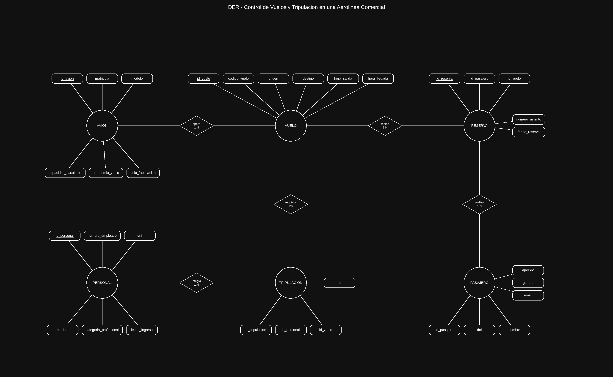
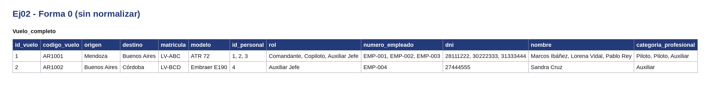
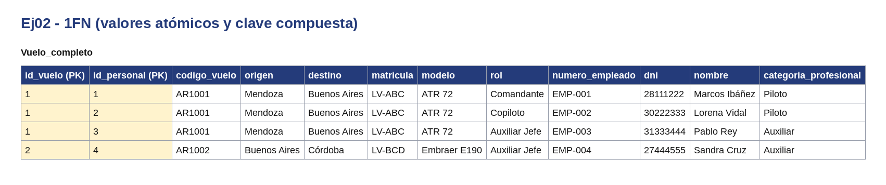
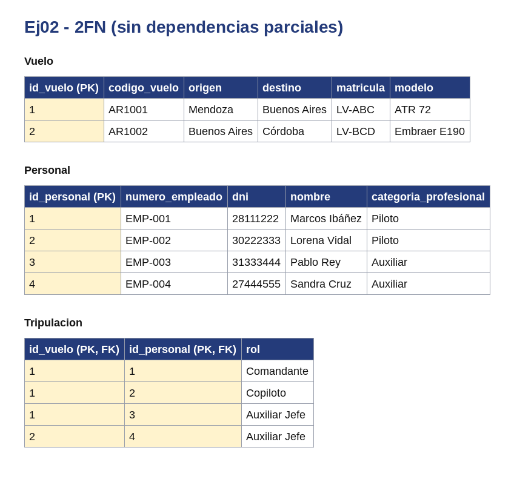
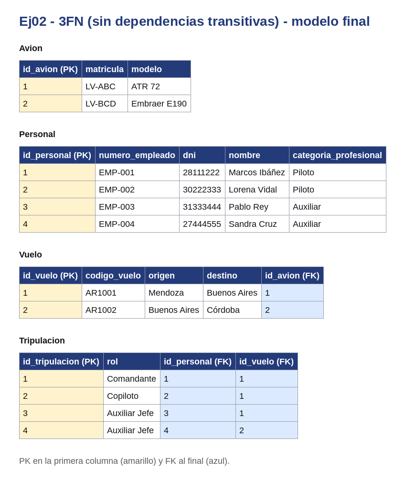

# Sistema de Control de Vuelos y Tripulación en una Aerolínea Comercial

Base de Datos - Unidad 2 - Ejercicio 2

## Consigna
Modelar mediante el Modelo Entidad-Relación (MER) la operación de vuelos de una aerolínea regional, incluyendo la administración de aeronaves, programación de vuelos, asignación de personal (pilotos y auxiliares) y gestión de reservas de pasajeros, garantizando el cumplimiento de normativas aeronáuticas.

## Lógica

### Entidades Principales:
- **AVIONES**: Identificados por matrícula, almacenan modelo, capacidad de pasajeros y autonomía de vuelo.
- **VUELOS**: Identificados por código único, registran origen, destino, horarios de salida y llegada.
- **PERSONAL**: Empleados (pilotos y auxiliares) identificados por número de empleado, con DNI, nombre, fecha de ingreso y categoría profesional.
- **PASAJEROS**: Identificados por DNI, almacenan nombre, apellido, género y email.

### Entidades Intermedias:
- **TRIPULACION**: Relación M:N entre Personal y Vuelos. Permite registrar qué empleados participan en cada vuelo y qué rol cumplen (Comandante, Copiloto, Auxiliar Jefe, etc.).
- **RESERVAS**: Relación M:N entre Pasajeros y Vuelos. Registra cada reserva con número de asiento y fecha de reserva.

### Relaciones:
- **OPERA (1:N)**: Un avión opera múltiples vuelos, pero un vuelo es operado por un único avión.
- **ASIGNACION/TRIPULACION (M:N)**: Un empleado participa en múltiples vuelos; un vuelo requiere múltiples empleados.
- **RESERVA (M:N)**: Un pasajero realiza múltiples reservas; un vuelo tiene múltiples pasajeros reservados.

### Decisiones de Diseño:
- Se utilizan entidades intermedias (Tripulación y Reservas) para resolver las relaciones M:N.
- El atributo "rol" en la entidad Tripulación permite registrar la función específica de cada empleado en cada vuelo.
- La entidad Reservas incluye número de asiento para controlar la disponibilidad por vuelo.
- Se separó completamente Personal en una sola entidad (sin subdividir Pilotos/Auxiliares) porque ambos comparten los mismos atributos; la distinción se realiza mediante categoría_profesional.

## Resultado

Atributo agregado para llegar al id más 5: `anio_fabricacion` (Avión).

---

## Normalización

Se normaliza el documento `Vuelo` con sus registros de `Tripulacion`. En todas las tablas la PK va en la primera columna y las FK al final. Los datos son de ejemplo.

**Forma 0.** Una sola tabla con todo junto. Hay celdas con listas: cada vuelo puede tener varios registros de tripulacion.

**1FN.** Cada elemento de la lista pasa a su propia fila y la clave queda compuesta: (`id_vuelo`, `id_personal`).

**2FN.** Los datos de vuelo dependen solo de `id_vuelo` y los de personal solo de `id_personal`. Se separan en `Vuelo` y `Personal`; `Tripulacion` queda con la clave compuesta y lo que depende de ambos.

**3FN.** Los datos de `Avion` dependen de su propio identificador y no de la PK de vuelo, así que pasan a tablas aparte. En el modelo final cada tabla usa su id propio.

